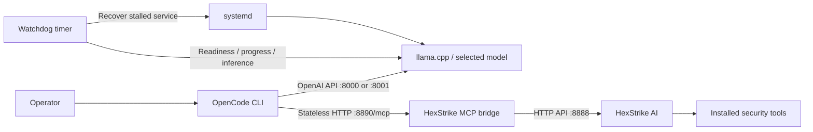

# The Pharaoh Agent V5

### Local AI infrastructure for authorized security testing

[](https://github.com/I7MD979/The_Pharoh_Agent_V5/actions/workflows/validate.yml)


Run a local language model, an agent CLI, and a security tools API as one managed stack. Pharaoh connects **OpenCode**, **llama.cpp**, and **HexStrike AI** through a dedicated **Model Context Protocol (MCP)** bridge, with systemd services and automatic detection of stalled inference. Both models can drive the HexStrike tools from OpenCode.

Inference runs on your own GPU. Installation downloads model weights and dependencies; individual tools may access external services depending on your requests.

[Quick start](#quick-start) · [Architecture](#architecture) · [Requirements](#requirements) · [Operations](#operations) · [Automatic recovery](#automatic-recovery) · [Troubleshooting](#troubleshooting)

## Highlights

- **Local models.** Choose Qwen3.8-27B or CyberStrike-OffSec-35B in Q8_0 GGUF format. Both serve an OpenAI-compatible API and use the HexStrike MCP tools.
- **Agent integration:** OpenCode uses the local provider and remote HexStrike MCP tools.
- **Both models use tools.** CyberStrike is wired to the same MCP bridge, with Code Mode and a bounded tool-output budget to fit its 32k context.
- **Stateless MCP:** an independent HTTP bridge uses the official Python SDK without modifying upstream HexStrike source.
- **Service management:** systemd handles startup, process failures, and service ordering.
- **Inference monitoring:** readiness checks, token progress tracking, and bounded inference probes detect an alive but unresponsive model.
- **Recoverable installation:** staged llama.cpp upgrades retain the previous installation; tool failures produce logs and an unsuccessful exit status.
- **Isolated Python dependencies:** Hugging Face and tool CLIs use virtual environments.

## Architecture



| Component | Purpose | Endpoint / service |
| --- | --- | --- |
| llama.cpp | GPU inference and OpenAI-compatible API | `:8000` for Qwen or `127.0.0.1:8001` for CyberStrike · `llama-cyberstrike.service` |
| HexStrike AI | Executes installed security tools | `:8888` · `hexstrike.service` |
| MCP bridge | Exposes tools to the agent | `127.0.0.1:8890/mcp` · `hexstrike-bridge.service` |
| OpenCode | Interactive and scripted agent interface | `opencode` |
| Watchdog | Checks inference and recovers stalls | `llama-watchdog.timer` / `.service` |

The diagram shows the OpenCode path for either model. Qwen listens on `:8000`; CyberStrike binds to loopback `:8001`. Both options use the same `llama-cyberstrike` service, and the watchdog follows the selected API port. The HexStrike API and MCP bridge are installed for both models, so CyberStrike works as an agentic reviewer that can run tools, not just a chat endpoint.

The bridge runs independently of the agent. Fresh MCP connections do not rely on a previous session's pipe or session ID. A transport change cannot repair stalled GPU inference; the watchdog monitors the model separately.

## Requirements

| Requirement | Details |
| --- | --- |
| OS | Ubuntu **22.04 or 24.04**, x86_64, with systemd running |
| Reference hardware | **96 GB RAM / 48 GB NVIDIA VRAM**; actual needs vary with context and configuration |
| NVIDIA driver | `nvidia-smi` must detect a working GPU before installation |
| CUDA toolkit | Needed for source builds; the installer can install NVIDIA's `cuda-toolkit-12-8` |
| Storage | Approximately 29 GB for Qwen or 37.8 GB for CyberStrike. Allow about 67 GB to retain both, plus space for tools, caches, builds, and upgrade backups. |
| Permissions | A user with sudo access, or a root account on a root-only server |
| Network | Access to Ubuntu repositories, GitHub, Hugging Face, package registries, and NVIDIA's repository when needed |

Ubuntu 22.04 is the original reference target. The installer also accepts Ubuntu 24.04; preflight acceptance does not establish compatibility of every third-party tool. Native Windows and Git Bash are unsupported targets. WSL requires an Ubuntu distribution with systemd and working GPU access.

Both models use **q8_0 KV cache**, flash attention, and full GPU offload. Context defaults depend on the selected model.

## Quick start

Run on the target Ubuntu machine as the account that will own the installation:

```bash
git clone https://github.com/I7MD979/The_Pharoh_Agent_V5.git
cd The_Pharoh_Agent_V5
bash install.sh --check
bash install.sh
```

| Menu | Model | Context | API base URL and alias |
| --- | --- | --- | --- |
| 1 | Qwen3.8-27B Abliterated Q8_0 | 131,072 tokens | `http://127.0.0.1:8000/v1` · `pharaoh-agent` |
| 2 | CyberStrike-OffSec-35B Abliterated Q8_0 | 32,768 tokens | `http://127.0.0.1:8001/v1` · `pharaoh-review` |

Both choices install llama.cpp, HexStrike AI, the MCP bridge, OpenCode, and the security toolset. CyberStrike keeps a 32,768-token context, so it uses Code Mode for tool access and a smaller output budget.

The installer displays the menu on the terminal when `PHARAOH_MODEL` is unset. Press Enter to keep the configured model or select Qwen on a fresh install. Without an interactive terminal, set `PHARAOH_MODEL=qwen` or `PHARAOH_MODEL=cyberstrike` explicitly.

Allow time for the download and any CUDA or tool builds. A persistent terminal such as `tmux` keeps remote installations running across SSH disconnects. The preflight checks Ubuntu, systemd, and GPU visibility.

Run `bash install.sh` as the installation account. The installer uses sudo when it needs elevated permissions.

### Update and switch models

From the existing checkout on Ubuntu, run the following and choose a model from the menu.

```bash
git pull --ff-only origin main && bash install.sh
```

To switch directly to CyberStrike, run `PHARAOH_MODEL=cyberstrike bash install.sh`. To switch back, run `PHARAOH_MODEL=qwen bash install.sh`.

If the existing service is running, it continues serving during download and file validation. Switching restarts inference and interrupts active requests. If activation or the inference check fails, the installer attempts to restore the previous systemd units and restart the previous service if it was running. Both GGUF files can stay in `~/models` for later switches.

If Git reports local changes in `install.sh`, `start-stack.sh`, or `stop-stack.sh`, inspect them with `git diff -- install.sh start-stack.sh stop-stack.sh`. If the diff only shows `100644` to `100755` mode changes, save them before pulling.

```bash
git stash push -m "Local script permissions" -- install.sh start-stack.sh stop-stack.sh &&
git pull --ff-only origin main
```

The commands in this README invoke the scripts through Bash and work with either permission mode.

### Installation stages

| Step | Script | Result |
| --- | --- | --- |
| 1 | `01-install-llamacpp.sh` | Tries a CUDA release, falls back to source, validates reasoning controls and CUDA device detection before replacing the managed installation |
| 2 | `02-download-model.sh` | Downloads the GGUF and validates its header and exact expected remote file size |
| 3 | `03-setup-services.sh` | Installs the model service and watchdog, waits for readiness, and tests chat inference |
| 4 | `04-install-hexstrike.sh` | Installs HexStrike dependencies, core tools, the API service, and stateless MCP launcher |
| 5 | `05-install-opencode.sh` | Ensures Node.js 22+, installs the current `@opencode/cli@latest` on every run, and configures the local provider and MCP |
| 6 | `06-install-all-tools.sh` | Attempts the extended apt, Go, Python, Ruby, release-binary, and source-built toolset |
| 7 | `07-verify.sh` | Checks real API responses, installed core tools, MCP registration/execution, the watchdog timer, and a real OpenCode tool call |

All numbered scripts live in `scripts/`. When the installer finds the model unit and `llama-server` on an existing host, it starts at step 2. A resumed installation stops after step 3 only when the bridge, the `pharaoh` launcher, and an OpenCode profile for the selected model are already present.

Replaced llama.cpp installations are retained as `~/llama.cpp.backup.<timestamp>.<pid>`. Existing OpenCode configuration is backed up before regeneration. If a stage fails, fix its reported error and rerun that script or the master installer.

The extended tool stage collects failures and **exits unsuccessfully if any were recorded**. For a previous failure in step 6, rerun that stage directly after resolving the reported error, since an existing installation can finish at step 3.

### Model defaults

| Setting | Value |
| --- | --- |
| Qwen file | `Huihui-Qwen3.8-27B-abliterated-Q8_0.gguf` |
| CyberStrike file | `Huihui-CyberStrike-OffSec-35B-abliterated-Q8_0.gguf` |
| OpenCode model for Qwen | `local/pharaoh-agent` |
| OpenCode model for CyberStrike | `local/pharaoh-review` |
| Reasoning | Enabled, `xhigh`, preserved across turns |
| Sampling | Temperature `1.0`, top-p `0.95`, top-k `20`, min-p `0` |
| OpenCode output limit | `32,768` tokens (Qwen) / `8,192` tokens (CyberStrike) |
| MCP tools | Code Mode, `execute` tool, 1-hour tool-call timeout |

The optional vision projector is not downloaded. Installation smoke tests disable thinking only for their small test requests; normal agent requests retain the configured reasoning defaults.

## Usage

### CyberStrike review API

Check that the local endpoint lists `pharaoh-review`.

```bash
curl -fsS --max-time 10 http://127.0.0.1:8001/v1/models
```

Use `http://127.0.0.1:8001/v1` as the base URL and `pharaoh-review` as the model ID in your API client for code and findings review.

On the Ubuntu desktop that runs the service, open [the local llama.cpp chat](http://127.0.0.1:8001/) if the installed build includes the web UI.

### CyberStrike in OpenCode

With `pharaoh-review` running and OpenCode 2.2.7 or newer installed on the same Ubuntu host, run this from the repository:

```bash
bash scripts/opencode-review.sh
```

This opens a separate OpenCode session with `pharaoh-local/pharaoh-review` selected. Paste code or findings into the chat for review. The session loads the HexStrike MCP tools, so the model can validate a finding with `nmap`, `nuclei`, `sqlmap`, and the other installed tools while it answers. It uses a temporary profile, so its chat history is discarded on exit.

The tool server must be running first; the launcher stops with a message if `127.0.0.1:8890` is not listening. Because CyberStrike has a 32,768-token window, tools are exposed through Code Mode and long tool output is capped.

### CyberStrike with the installed launcher

`pharaoh` selects the model from the installed configuration. After switching to CyberStrike it opens `local/pharaoh-review` with the same MCP tools:

```bash
pharaoh
opencode run "Scan 127.0.0.1 with nmap_scan and report the open ports."
```

### Qwen with OpenCode

```bash
pharaoh
opencode run "List the tools available from the HexStrike MCP server."
opencode run "Explain the results of my authorized assessment."

curl -fsS --max-time 10 http://127.0.0.1:8000/v1/models
curl -fsS --max-time 10 http://127.0.0.1:8888/health

bash scripts/07-verify.sh
```

Run `pharaoh` on the Ubuntu host that serves the model. The launcher selects the configured local model (`local/pharaoh-agent` for Qwen, `local/pharaoh-review` for CyberStrike) using the installation account's configuration. It uses a private server when OpenCode supports `--standalone`, which avoids conflicts on the shared OpenCode port.

To update OpenCode on an existing installation, run `bash scripts/05-install-opencode.sh` from the project directory. This installs the current npm `latest` release and updates the `pharaoh` launcher to use that executable.

If the local model is missing from the picker, check `curl -fsS http://127.0.0.1:8000/v1/models` on that same host. If it lists `pharaoh-agent`, run `bash scripts/05-install-opencode.sh` as the installation user and reopen with `pharaoh`. If the endpoint is down, check `systemctl status llama-cyberstrike` and its journal.

Verification checks registered MCP tool names and actual `tools_status` values, then calls `nmap_scan` through MCP against **127.0.0.1:8000**. It does not infer success from an agent mentioning tool names or open ports, and it does not scan external hosts by default.

## Operations

```bash
bash start-stack.sh
bash stop-stack.sh

systemctl status llama-cyberstrike --no-pager
systemctl status llama-watchdog.timer --no-pager
systemctl list-timers llama-watchdog.timer
```

The start helper starts inference, the installed API and bridge services, and the watchdog. The stop helper stops inference, the watchdog, and any installed API and bridge services.

### Logs and diagnostics

```bash
journalctl -u llama-cyberstrike -f
journalctl -u hexstrike -f
journalctl -u hexstrike-bridge -f
journalctl -u llama-watchdog.service -n 80 --no-pager

nvidia-smi
curl -fsS --max-time 10 http://127.0.0.1:8000/slots  # Qwen
curl -fsS --max-time 10 http://127.0.0.1:8001/slots  # CyberStrike
```

| Location | Contents |
| --- | --- |
| `~/pharaoh-tools-install.log` | Detailed extended tool installation output |
| `~/pharaoh-tool-failures.txt` | Collected tool failures; removed after a failure-free run |
| `/var/log/pharaoh-watchdog/latest-diagnostic.log` | Latest pre-recovery model logs, GPU status, and memory summary |
| `/var/lib/pharaoh-watchdog/state.json` | Watchdog progress/failure state |

### Network boundaries

The CyberStrike review API and MCP bridge bind to loopback. Qwen binds to all interfaces, and the upstream HexStrike API may do so as well. Restrict access to trusted clients and use an SSH tunnel or explicit access controls for remote clients.

## Automatic recovery

**`active (running)` does not guarantee that inference is working.** The watchdog runs once a minute after the previous check finishes and uses three signals:

1. **Readiness:** `/health` must respond with a ready status.
2. **Busy-slot progress:** task identity and token counters are compared between checks. Advancing generation can continue for hours without a stall restart.
3. **Idle inference:** approximately every five minutes while idle, a bounded one-token native completion checks that inference actually works.

| Threshold | Default | Purpose |
| --- | --- | --- |
| Startup grace | 900 seconds | Allows model loading before checks begin |
| Busy stall limit | 1,800 seconds | Recovers a busy model with no observable task/token progress |
| Inference probe timeout | 120 seconds | Bounds the idle inference test |
| Consecutive failures | 3 | Avoids recovery on a single failed check |

Before recovery, diagnostics are saved and service state is checked again. A restart is requested only if the model remains active. Restarting interrupts in-flight requests. Long prompt processing with no exposed progress can also reach the stall limit; tune it for your workload.

This is a recovery mechanism, **not a confirmed diagnosis** of a particular GPU, context, model, or agent issue. Driver faults requiring a GPU reset or reboot may survive a service restart. Investigate repeated recovery events using the saved diagnostics.

To adjust thresholds:

```bash
sudo systemctl edit llama-watchdog.service
```

```ini
[Service]
Environment=STARTUP_GRACE_SECONDS=1200
Environment=STALL_SECONDS=3600
Environment=PROBE_TIMEOUT_SECONDS=180
TimeoutStartSec=300
```

```bash
sudo systemctl daemon-reload
sudo systemctl restart llama-watchdog.timer
```

## Configuration

| Source | Role / installed location |
| --- | --- |
| `scripts/common.sh` | Model identity, paths, ports, and installation helpers |
| `config/opencode.json` | Template for `~/.config/opencode/opencode.json`; holds the selected model and the `hexstrike` MCP server |
| `config/opencode-review.json` | Temporary profile used by `scripts/opencode-review.sh` |
| `systemd/llama-cyberstrike.service` | Model service template |
| `systemd/hexstrike*.service` | API and MCP service templates |
| `systemd/llama-watchdog.*` | Monitoring service and timer |
| `scripts/hexstrike_bridge.py` | Copied to `~/Hexstrike-AI/pharaoh_bridge.py` |

### Context size and GPU offload

Edit the model service's `ExecStart` settings: for example, lower `-c 131072` to `-c 65536` or `-c 32768`. Keep the OpenCode model context limit in sync, and monitor actual allocation with `nvidia-smi`.

```bash
sudo systemctl daemon-reload
sudo systemctl restart llama-cyberstrike
```

Installer reruns can replace generated units. Update repository templates for persistent installer defaults, or maintain systemd overrides. Replacing `ExecStart` in an override requires clearing the original with an empty `ExecStart=` first.

### Use a different GGUF

For the two supported GGUF files, use the [installer to switch models](#update-and-switch-models). For a custom GGUF, update the service's `-m` path and review context, cache, sampling, and reasoning settings. Keep the service alias in sync with the client configuration.

To change the installer's default checkpoint, update the model profile in `scripts/common.sh` (including its `PROVIDER_NAME`, context, and output budget) and generation settings in the systemd template.

## Troubleshooting

| Symptom | Action |
| --- | --- |
| Unsupported platform / systemd unavailable | Run on the target Ubuntu host. Enable systemd first when using WSL. |
| Model menu missing | Update the checkout and run `bash install.sh` from an interactive terminal with `PHARAOH_MODEL` unset, or select it directly with `PHARAOH_MODEL=cyberstrike bash install.sh`. |
| APT reports `File has unexpected size` for a package index | The repository served an index that differs from its release metadata. Retry `sudo apt-get update` after the mirror synchronizes. If the error appears during bootstrap, it must clear before the installer reaches the numbered stages. |
| `nvidia-smi` missing or failing | Fix the driver and GPU visibility before installation; a toolkit alone does not repair the driver. |
| Prebuilt fails with `GLIBC_*` or CUDA runtime errors | Step 1 falls back to source and validates the replacement before promoting it. |
| CMake cannot locate CUDA | Use a complete NVIDIA toolkit. Step 1 passes its compiler and matching `CUDAToolkit_ROOT`; a distro `nvcc` on PATH alone is insufficient. |
| CUDA compilation exhausts RAM | Try `BUILD_JOBS=2 bash scripts/01-install-llamacpp.sh`. |
| Compute capability cannot be detected | Supply the appropriate architecture, e.g. `CUDA_ARCHITECTURES=86 bash scripts/01-install-llamacpp.sh` for a suitable Ampere GPU. |
| Incomplete/invalid model download | Step 2 validates remote size and the GGUF header, then downloads again if needed. |
| GPU out of memory / service restart loop | Inspect the model journal and `nvidia-smi`; reduce context/offload or choose a smaller quantization. |
| Service active but generation stops after hours | Inspect watchdog logs and `latest-diagnostic.log` to distinguish inference timeouts, lack of progress, and memory/driver failures. |
| Extended tool stage fails | Review `~/pharaoh-tool-failures.txt` and `~/pharaoh-tools-install.log`, fix reported errors, and rerun step 6. |
| MCP bridge does not start | Check `journalctl -u hexstrike-bridge`; rerun step 4 to install the SDK and launcher. |
| OpenCode cannot reach MCP | Confirm `127.0.0.1:8890/mcp` is listening and the generated configuration uses `type: remote` under `mcp.servers`. |
| Model answers without calling tools | Confirm `capabilities.tools` is `true`, that `--jinja` is in the model unit, and check the model journal for a tool-template warning. Reduce the prompt, or set `codemode: false` on `hexstrike` to expose tools directly. |
| Tool calls fail with context errors | CyberStrike has a 32,768-token window. Keep prompts short, lower `tool_output.max_bytes`, or use Qwen for long sessions. |
| CyberStrike stops answering after a large tool result | Restart inference (`sudo systemctl restart llama-cyberstrike`) and rescan a narrower target; the bridge stays connected independently. |
| Empty final chat content | Increase the token budget for reasoning requests. Installation tests disable thinking for their small probes. |
| Python CLI conflicts | Rerun step 6 to install CLIs in isolated environments; avoid adding packages to system Python. |

## Development and validation

```bash
for script in *.sh scripts/*.sh; do bash -n "$script"; done
python3 -m venv .test-venv
.test-venv/bin/python -m pip install 'mcp>=1.12,<2'
.test-venv/bin/python -m unittest discover -s tests -v
```

Tests cover simulated five-hour generation, stalled generation, inference failures behind a healthy HTTP endpoint, startup grace, manual service stops, repeated fresh-client MCP initialize/list/call requests against a local fixture, and rendering of the OpenCode profile for both models. They do not need a GPU or execute security scans. CI runs on Python 3.10 and 3.12.

Run the installer on your Ubuntu/GPU host for runtime validation. Step 3 checks the selected model's alias and chat response. Step 7 verifies the direct MCP path and an actual tool call through OpenCode with the selected model.

## Repository layout

```text
.
├── install.sh                   # Master installer and preflight
├── start-stack.sh / stop-stack.sh
├── config/opencode.json         # Provider and MCP template
├── systemd/                     # Model, API, bridge, watchdog service/timer
├── scripts/
│   ├── common.sh                # Shared installation helpers
│   ├── 01-install-llamacpp.sh
│   ├── 02-download-model.sh
│   ├── 03-setup-services.sh
│   ├── 04-install-hexstrike.sh
│   ├── 05-install-opencode.sh
│   ├── 06-install-all-tools.sh
│   ├── 07-verify.sh
│   ├── hexstrike_bridge.py      # Stateless MCP launcher
│   ├── llama_watchdog.py        # Inference monitoring and recovery
│   └── verify_stack.py          # Real API and local MCP checks
├── tests/                       # Recovery and MCP transport tests
└── .github/workflows/validate.yml
```

## Upstream projects

- [llama.cpp](https://github.com/ggml-org/llama.cpp) — inference runtime.
- [HexStrike AI](https://github.com/netcuter/Hexstrike-AI) — tools API and MCP definitions.
- [OpenCode](https://opencode.ai/) — agent CLI.
- [Official Python MCP SDK](https://github.com/modelcontextprotocol/python-sdk) — Streamable HTTP transport.
- [Huihui Qwen3.8-27B GGUF](https://huggingface.co/huihui-ai/Huihui-Qwen3.8-27B-abliterated-GGUF)
- [Huihui CyberStrike-OffSec-35B GGUF](https://huggingface.co/huihui-ai/Huihui-CyberStrike-OffSec-35B-abliterated-GGUF)

Upstream projects, models, and installed tools retain their own licenses and requirements. Use security tools only on systems you own or are explicitly authorized to assess.
